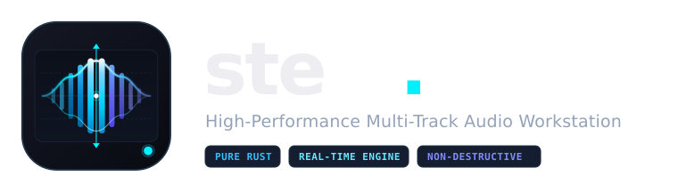
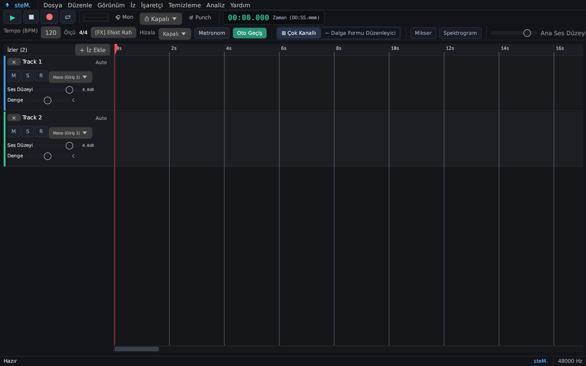
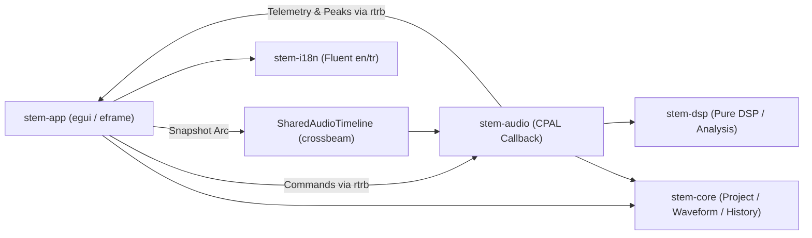

English | [Türkçe](README.tr.md)

<div align="center">



<h1>steM.</h1>

<p>Non-destructive, real-time multi-track audio workstation and waveform editor in Rust.</p>

<p>
  <a href="LICENSE"></a>
  <a href="https://github.com/MOzcelik14/steM/releases"></a>
  <a href="https://www.rust-lang.org/"></a>
  <a href="#system-requirements"></a>
  <a href="https://github.com/MOzcelik14/steM/actions/workflows/release.yml"></a>
  <a href="https://github.com/MOzcelik14/steM/commits/master"></a>
  <a href="https://github.com/MOzcelik14/prism-suite"></a>
</p>

<p>
  <a href="#overview">Overview</a> ·
  <a href="#features">Features</a> ·
  <a href="#installation">Installation</a> ·
  <a href="#getting-started">Getting Started</a> ·
  <a href="#keyboard-shortcuts">Keyboard Shortcuts</a> ·
  <a href="#architecture">Architecture</a> ·
  <a href="#development">Development</a>
</p>

<p>
  
</p>

</div>

---

## Overview

**steM.** is a desktop digital audio workstation (DAW) and waveform editor written in Rust. It combines a multi-track timeline for arrangement and mixing with a dedicated single-file waveform editor, real-time DSP effects, audio restoration tools, and broadcast loudness metering.

All timeline edits are non-destructive: original audio files on disk remain untouched while clip trims, fades, crossfades, gain envelopes, and effect chains are evaluated on the fly or rendered during export. A lock-free audio callback keeps playback and recording isolated from user interface updates and memory allocations.

Designed for podcasters, sound designers, voice editors, and independent musicians on Linux, Windows, and macOS, **steM.** ships as a standalone native binary with built-in English and Turkish localization.

## Highlights

- **Non-Destructive Multi-Track and Waveform Editing**: Arrange clips across up to 64 tracks with snap-to-grid, equal-power auto-crossfades, ripple delete, and dedicated waveform editing with zero-crossing snap.
- **Zero-Allocation Real-Time Audio Engine**: Lock-free `rtrb` ring buffers and atomic timeline swaps isolate the audio callback from UI rendering and disk I/O.
- **Integrated DSP and Restoration Suite**: Per-track, submix bus, and master effect chains alongside spectral repair, noise reduction, de-hum, de-clip, de-reverb, and click/pop removal.
- **Broadcast Metering and Mastering Analysis**: EBU R128 / ITU-R BS.1770 integrated, short-term, and momentary loudness measurement, true-peak ceiling checks, and reference track loudness/spectrum comparison.
- **Flexible Routing and Automation**: Submix busses with bus-to-bus routing, pre/post-fader auxiliary sends, track groups, Mid/Side and stereo width processing, sidechain ducking, and breakpoint automation.
- **Bilingual Native Interface**: Full English and Turkish UI powered by Fluent, switchable at runtime without restarting.

## Features

### Multi-Track Arrangement and Mixing

| Feature | Details |
| :--- | :--- |
| Track Capacity | Up to 64 tracks per project (`MAX_PROJECT_TRACKS`), with per-track Mute, Solo, Record Arm, Gain, and Pan |
| Clip Editing | Move, trim edges, split (`S` or `Ctrl+K`), duplicate (`Ctrl+D`), copy/cut/paste, and 2D marquee box selection (`Shift+Drag`) |
| Fades and Crossfades | Corner drag fade-in/fade-out handles, menu fade actions, Linear / Logarithmic / Exponential / S-Curve envelopes, and automatic Equal-Power crossfades |
| Snap and Selection | Grid snapping (`Off`, `Beat`, `HalfBeat`, `QuarterBeat`, `Second`, `Frame`), time range selection, silence selection, and ripple delete |
| Routing and Busses | Submix busses with bus-to-bus chaining, pre/post-fader auxiliary sends, track grouping (`link_gain`, `link_pan`, `link_mute`, `link_solo`, `link_arm`) |
| Stereo and Phase | Per-track left/right phase inversion, stereo width (`0.0` to `2.0`), Mid/Side gain matrixing, and external sidechain compression |
| Automation | Breakpoint lanes with Linear, Bezier, and Step curves for Volume, Pan, Send levels, EQ bands, Compressor, Reverb, and plugin parameters; range copy/paste |
| Markers and Templates | Timeline markers and CD cue points with chapter marker export; built-in workflow templates (`Empty`, `Podcast (2 Hosts)`, `Voiceover`, `Music Production`) |

### Waveform Editor and Restoration

| Feature | Details |
| :--- | :--- |
| Sample-Level Operations | Cut, copy, paste, delete, trim, insert 1 second of silence, reverse, phase invert, and peak normalization |
| Fade Curves | Selection or full-file fade-in and fade-out with Linear, Logarithmic, Exponential, and S-Curve shapes |
| Zero-Crossing Snap | Optional snapping of selection boundaries to the nearest zero crossing (`find_nearest_zero_crossing`) |
| Noise Reduction | Spectral noise profile capture and gated attenuation with adjustable reduction (dB) and sensitivity |
| Spectral Repair | Time-frequency region attenuation and spectral interpolation (healing) directly from the spectrogram view |
| Restoration Tools | 50/60 Hz harmonic Hum Remover, peak De-Clipper, broadband De-Reverberator, and transient Click/Pop Remover |
| Multi-Level Peak Cache | Hierarchical `PeakPyramid` cache for responsive rendering across zoom levels |

### Real-Time Effects, Recording, and Mastering

| Feature | Details |
| :--- | :--- |
| Insert Effects | Parametric Equalizer, Compressor (with sidechain key support), Brickwall Limiter, Delay, Reverb, Noise Gate, and De-Esser |
| Effect Chain Controls | Reorderable insert slots, per-slot bypass, parameter smoothing, and user-defined `EffectChainPreset` serialization |
| Recording Pipeline | Live input monitoring, configurable count-in (`Off`, 1 bar, 2 bars, 2s, 4s), punch-in/punch-out regions, Mono1/Mono2/Stereo input routing, and latency compensation |
| Visualizers and Metering | Peak/RMS VU meters, 1D FFT spectrum analyzer, 2D waterfall spectrogram with configurable color palettes, and phase/correlation metering |
| Mastering Assistant | Full dynamics analysis (RMS, Crest Factor, PLR, clipped samples), 3-band tonal balance, safe gain suggestion, A/B unity comparison, and reference audio loudness/spectrum delta |
| Export and Batching | Single-file, track stem, surround 5.1 WAV, and background batch export with filename tokens, TPDF dithering, LUFS normalization, and true-peak limiting |

## Screenshots

| View | Preview |
| :--- | :--- |
| Multi-Track Timeline and Mixer |  |
| Waveform Editor and Spectrogram | `docs/images/waveform.png` (pending) |
| Effects Rack and Mastering Assistant | `docs/images/mastering.png` (pending) |

## Installation

### Prebuilt Binaries (GitHub Releases)

Download standalone archives for Linux (`x86_64`), Windows (`x86_64`), and macOS (`arm64`) from [GitHub Releases](https://github.com/MOzcelik14/steM/releases), along with `SHA256SUMS.txt` and build provenance attestations for verification.

**Linux (`x86_64`):**

```bash
tar -xzf stem-0.6.1-linux-x86_64.tar.gz
cd stem-0.6.1-linux-x86_64
./stem
```

**Windows (`x86_64`):**

Extract `stem-0.6.1-windows-x86_64.zip` and run `stem.exe`.

**macOS (`arm64`):**

Open `stem-0.6.1-macos-arm64.dmg` (or extract `stem-0.6.1-macos-arm64.tar.gz`) and run `steM.`.

You can also install and manage **steM.** through [prisM. Suite](https://github.com/MOzcelik14/prism-suite).

### Building from Source

#### Debian / Ubuntu Prerequisites

Install the Rust toolchain (1.88+ recommended; `rust-toolchain.toml` pins the tested CI version) and the system libraries used in CI:

```bash
sudo apt-get update
sudo apt-get install -y --no-install-recommends \
  pkg-config build-essential libasound2-dev libx11-dev \
  libgl1-mesa-dev libxkbcommon-dev libwayland-dev \
  libxcb-render0-dev libxcb-shape0-dev libxcb-xfixes0-dev
```

#### Build and Run

```bash
git clone https://github.com/MOzcelik14/steM.git
cd steM
cargo build --locked --release -p stem-app
./target/release/stem
```

On Windows (MSVC), no extra C/C++ audio packages are required beyond the standard MSVC build tools and Rust toolchain:

```powershell
git clone https://github.com/MOzcelik14/steM.git
cd steM
cargo build --locked --release -p stem-app
.\target\release\stem.exe
```

## Getting Started

1. Launch **steM.** (`./target/release/stem`). By default, it opens in the Multi-Track view with two tracks.
2. Import audio using **File -> Import Audio** or drag and drop `.wav`, `.flac`, `.mp3`, `.ogg`, or `.m4a` files onto a track lane. Alternatively, use **File -> Open Demo Project** to inspect a prebuilt session.
3. Click and drag a clip to move it along the timeline, drag its left or right edges to trim, or drag the upper corners to set fade-in and fade-out lengths.
4. Hold `Shift` and drag to draw a 2D marquee box across clips, or drag on empty canvas space to create a time range selection.
5. Double-click any clip (or press `2`) to inspect and edit it in the Waveform Editor, then click **Apply to Project** to commit waveform changes back to the timeline.
6. Open the **Mixer** or **Effects** panels to adjust track levels, pan, stereo width, submix busses, and insert effects.
7. Export the finished mixdown or individual stems via **File -> Export Audio** (`Ctrl+E`).

## Keyboard Shortcuts

Default bindings defined in `KeyBindingMap` and `shortcuts.rs` (customizable via the Keybindings dialog):

| Shortcut | Action | Context |
| :--- | :--- | :--- |
| `Space` | Play / Pause | Global |
| `Escape` | Stop playback / Clear selection | Global |
| `R` | Toggle Record | Global |
| `L` | Toggle Loop | Global |
| `Home` | Seek to frame 0 | Global |
| `1` / `2` | Switch to Multi-Track / Waveform view | Global |
| `F12` | Toggle Spectrogram panel | Global |
| `Ctrl+N` / `Ctrl+O` / `Ctrl+S` | New / Open / Save Project | Global |
| `Ctrl+E` | Open Export dialog | Global |
| `Ctrl+A` | Select all (waveform or project range) | Global |
| `Ctrl+Z` / `Ctrl+Y` (`Ctrl+Shift+Z`) | Undo / Redo | Global |
| `Ctrl+X` / `Ctrl+C` / `Ctrl+V` | Cut / Copy / Paste | Global |
| `Delete` / `Backspace` | Delete selection or selected clip | Global |
| `Ctrl+=` / `Ctrl+-` | Zoom In / Zoom Out | Global |
| `M` / `Shift+M` | Drop Marker / Named Marker dialog | Global |
| `[` / `]` | Jump to Previous / Next Marker | Global |
| `S` or `Ctrl+K` | Split selected clip at playhead | Multi-Track |
| `Ctrl+D` | Duplicate selected clip | Multi-Track |
| `Ctrl+T` / `Ctrl+I` | Trim to selection / Insert 1s silence | Waveform |

## Supported Formats

| Category | Formats / Containers | Notes |
| :--- | :--- | :--- |
| Audio Import | WAV, FLAC, MP3, OGG Vorbis, AAC/M4A | Decoded off-thread via Symphonia into 32-bit float PCM (`8 kHz`–`192 kHz`, up to 8 channels) |
| Audio Export | WAV (16-bit, 24-bit, 32-bit float), FLAC, MP3, OGG Vorbis | Supports stereo mixdown, per-track stems, batch export, and 6-channel 5.1 surround WAV |
| Project Files | `.stem`, `.ron` | Human-readable RON serialization with schema validation |
| Presets and Keymaps | `.ron` (effect presets), `stem_keybindings.json` | User effect chain presets stored in project; keybindings exportable as JSON |
| Marker Lists | `.txt` | Chapter marker export from timeline markers |

## Configuration and Data

- **Project Files (`.stem`)**: Saved atomically via a temporary sibling file (`.stem.tmp`) and rename. Saving over an existing project can also create a `.stem.bak` backup.
- **Collect All and Save**: Copies external audio sources referenced by the project into an `Audio/` directory next to the `.stem` project file and updates source paths.
- **Crash Recovery Journal (`.stem-recovery`)**: Periodically written to the current working directory during editing. On startup, if a non-empty `.stem-recovery` file is present, **steM.** prompts to restore or discard the unsaved session.
- **Keybindings Export**: Custom keyboard mappings can be exported to and imported from `stem_keybindings.json` via the Keybindings dialog.

## System Requirements

| Component | Minimum / Supported |
| :--- | :--- |
| Operating System | Linux (`x86_64`), Windows 10/11 (`x86_64`), or macOS (`arm64`) |
| Audio Backend | ALSA, PulseAudio, or PipeWire (via ALSA/CPAL) on Linux; WASAPI on Windows; CoreAudio on macOS |
| Graphics | OpenGL-capable GPU and X11 or Wayland display server on Linux; DirectX/OpenGL on Windows; Metal/OpenGL on macOS |
| Build Toolchain | Rust 1.88 or newer (`stable`) with `pkg-config` and development headers on Linux |

## Architecture

**steM.** is organized as a five-crate Cargo workspace with strict separation between data models, pure DSP, audio I/O, localization, and the GUI:

| Crate | Responsibility |
| :--- | :--- |
| `stem-core` | Project model (`Project`, `Track`, `Clip`, `SubmixBus`, `AutomationLane`), RON serialization/validation, undo/redo history, `WaveformDocument`, and `PeakPyramid` |
| `stem-dsp` | Pure DSP algorithms with zero I/O or UI dependencies: biquad filters, dynamics (`Compressor`, `Limiter`, `NoiseGate`, `DeEsser`), `Delay`, `Reverb`, `StereoProcessor`, `Surround51Pan`, `EffectChain`, FFT spectrum/spectrogram, `SpectralRepair`, `Resampler`, `TpdfDither`, and `ebur128` analysis |
| `stem-audio` | `cpal` playback/recording engine, lock-free `rtrb` command/telemetry/monitor rings, `Symphonia` decoding, offline export/stem rendering, plugin bundle scanning metadata, and batch processing |
| `stem-i18n` | Compile-time embedded Fluent localization bundles (`en.ftl`, `tr.ftl`), system locale detection, runtime switching, and audio formatting helpers |
| `stem-app` | `eframe` / `egui` desktop UI (`views/` for timeline, waveform, mixer, effects, spectrogram, transport, dialogs) and application action dispatch (`app/`) |



## Roadmap

Core editing, DSP, spectral restoration, mastering analysis, advanced automation, advanced mixing/routing, and workflow improvements are tracked in [ROADMAP.md](ROADMAP.md). The primary remaining verification item is manual hardware testing across PipeWire, JACK, and ALSA audio servers on physical Linux setups.

## FAQ and Troubleshooting

**No sound is heard during playback on Linux.**
Ensure an active output device is selected in **Preferences / Audio Devices**, verify that your user session has access to PulseAudio/PipeWire/ALSA, and check that the track is not muted or another track is not soloed.

**ALSA prints `dmix` or `dsnoop` warnings in the terminal.**
CPAL probes available ALSA PCM devices at startup. These messages come from `libasound` probing virtual/capture nodes and do not prevent playback once a working output device is selected.

**Why does dragging a clip move it instead of selecting an audio range?**
In Multi-Track view, dragging a clip moves it along the timeline. To select a time range, drag on empty track space or hold `Shift` and drag to draw a 2D marquee selection box. Double-click a clip to open the Waveform Editor for direct sample-level drag selection.

**Why did a pasted clip not trigger a crossfade?**
Pasting places the new clip after overlapping clips on the target track by default so existing audio is not unintentionally crossfaded. Crossfades are created when you manually drag two clips into overlap while `Auto Crossfade` is enabled.

**Where are my source audio files stored when I edit?**
Source files remain untouched on disk. If you want a self-contained project folder, use **Collect All and Save** to copy external media into an `Audio/` subdirectory alongside the `.stem` project file.

**How do I switch between English and Turkish?**
Use the language selector in **File -> Preferences** (or the menu bar language toggle). Changes take effect immediately without restarting.

## Development

Run formatting, strict Clippy lints, workspace tests, and release builds before submitting changes:

```bash
cargo fmt --check
cargo clippy --workspace --all-targets -- -D warnings
cargo test --workspace
cargo build --locked --release -p stem-app
```

Follow Conventional Commits (`feat:`, `fix:`, `chore:`, `docs:`, `refactor:`, `test:`).

```text
steM/
├── assets/          # Application icons and SVG/PNG logos
├── crates/
│   ├── stem-app/    # Desktop GUI and action dispatch
│   ├── stem-audio/  # CPAL engine, Symphonia decode, export
│   ├── stem-core/   # Project model, history, peak pyramids
│   ├── stem-dsp/    # Pure DSP, FFT, EBU R128 analysis
│   └── stem-i18n/   # Fluent localization wrapper
├── docs/            # GitHub Pages site and docs/images/
├── fuzz/            # Fuzzing targets
└── locales/         # Fluent translation files (en.ftl, tr.ftl)
```

## Contributing

Contributions are welcome via issues and pull requests on [GitHub](https://github.com/MOzcelik14/steM). Keep `stem-dsp` free of I/O or UI dependencies, preserve zero-allocation invariants inside `stem-audio` real-time callbacks, and ensure `cargo fmt --check`, `cargo clippy --workspace --all-targets -- -D warnings`, and `cargo test --workspace` pass cleanly.

## Localization

**steM.** currently supports **English** (`locales/en.ftl`) and **Turkish** (`locales/tr.ftl`), embedded at compile time through `stem-i18n` using Project Fluent.

To add a new language:
1. Copy `locales/en.ftl` to `locales/<lang>.ftl` and translate all message keys.
2. Register the new `Locale` variant and embedded `include_str!` bundle in `crates/stem-i18n/src/lib.rs`.
3. Run `cargo test -p stem-i18n` to verify exact key parity across all locales.

## License

**steM.** is licensed under the **GNU General Public License v3.0 or later (`GPL-3.0-or-later`)**. See [LICENSE](LICENSE) for the full license text.

## Acknowledgements

**steM.** builds on open-source Rust crates including `eframe` / `egui`, `cpal`, `rtrb`, `symphonia`, `hound`, `flacenc`, `mp3lame-encoder`, `vorbis_rs`, `rubato`, `realfft`, `rustfft`, `ebur128`, `fluent-bundle`, `serde`, `ron`, `rfd`, and `crossbeam-channel`.

## Contact

- Repository: [https://github.com/MOzcelik14/steM](https://github.com/MOzcelik14/steM)
- Issues and Bug Reports: [https://github.com/MOzcelik14/steM/issues](https://github.com/MOzcelik14/steM/issues)
- Suite Home: [https://github.com/MOzcelik14/prism-suite](https://github.com/MOzcelik14/prism-suite)

---

<div align="center">
  <sub>Part of the prisM. Suite</sub>
</div>
