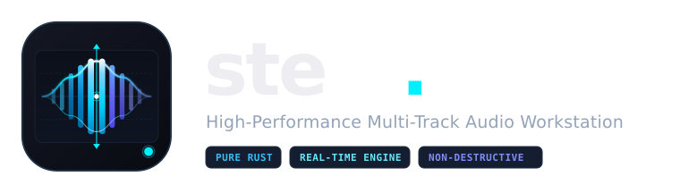
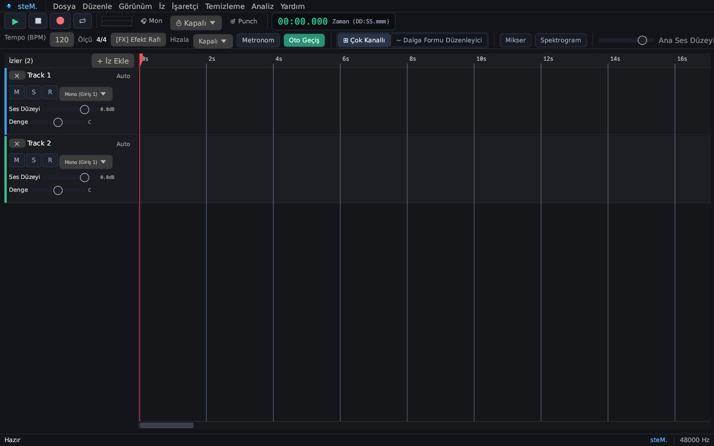
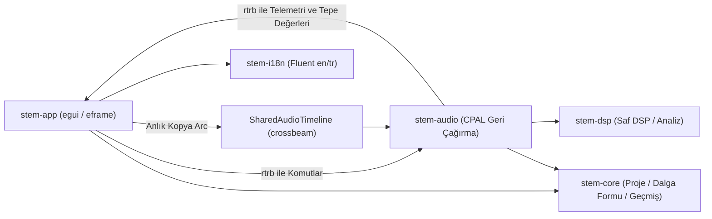

[English](README.md) | Türkçe

<div align="center">



<h1>steM.</h1>

<p>Rust ile yazılmış, tahribatsız ve gerçek zamanlı çok kanallı ses iş istasyonu ve dalga formu editörü.</p>

<p>
  <a href="LICENSE"></a>
  <a href="https://github.com/MOzcelik14/steM/releases"></a>
  <a href="https://www.rust-lang.org/"></a>
  <a href="#sistem-gereksinimleri"></a>
  <a href="https://github.com/MOzcelik14/steM/actions/workflows/release.yml"></a>
  <a href="https://github.com/MOzcelik14/steM/commits/master"></a>
  <a href="https://github.com/MOzcelik14/prism-suite"></a>
</p>

<p>
  <a href="#genel-bakış">Genel Bakış</a> ·
  <a href="#özellikler">Özellikler</a> ·
  <a href="#kurulum">Kurulum</a> ·
  <a href="#başlarken">Başlarken</a> ·
  <a href="#klavye-kısayolları">Klavye Kısayolları</a> ·
  <a href="#mimari">Mimari</a> ·
  <a href="#geliştirme">Geliştirme</a>
</p>

<p>
  
</p>

</div>

---

## Genel Bakış

**steM.**, Rust ile geliştirilmiş bir masaüstü sayısal ses iş istasyonu (DAW) ve dalga formu editörüdür. Düzenleme ve miksaj için çok kanallı zaman çizelgesini; tek dosya dalga formu editörü, gerçek zamanlı DSP efektleri, ses onarım araçları ve yayın standardında ses yüksekliği ölçümüyle bir araya getirir.

Zaman çizelgesindeki tüm düzenlemeler tahribatsızdır (non-destructive): diskteki özgün ses dosyalarına dokunulmaz; klip kırpmaları, fade eğrileri, geçişler (crossfade), kazanç zarfları ve efekt zincirleri anlık olarak hesaplanır veya dışa aktarım sırasında işlenir. Kilit içermeyen (lock-free) ses geri çağırma hattı, çalma ve kayıt işlemlerini arayüz güncellemelerinden ve bellek ayırmalarından izole eder.

Linux ve Windows üzerindeki podcast yayıncıları, ses tasarımcıları, ses editörleri ve bağımsız müzisyenler için tasarlanan **steM.**, dahili İngilizce ve Türkçe dil desteğiyle tek parça yerel bir uygulama olarak sunulur.

## Öne Çıkanlar

- **Tahribatsız Çok Kanallı ve Dalga Formu Düzenleme**: 64 kanala kadar destekli zaman çizelgesinde ızgaraya hizalama, otomatik eşit güçlü geçişler (Equal-Power crossfade), dalgalı silme (ripple delete) ve sıfır geçişine hizalamalı dalga formu düzenleme.
- **Bellek Ayırmasız Gerçek Zamanlı Ses Motoru**: Kilit içermeyen `rtrb` halka tamponları ve atomik zaman çizelgesi değişimleri, ses iş parçacığını arayüz ve disk G/Ç işlemlerinden tamamen ayırır.
- **Bütünleşik DSP ve Ses Onarım Paketi**: Kanal, alt miks (submix bus) ve ana çıkış efekt zincirlerinin yanında spektral onarım, gürültü azaltma, 50/60 Hz uğultu giderme, kırpma (de-clip), yankı bastırma (de-reverb) ve çıtırtı/patlama temizleme araçları.
- **Yayın Standardında Ölçüm ve Mastering Analizi**: EBU R128 / ITU-R BS.1770 bütünleşik, kısa süreli ve anlık ses yüksekliği ölçümü, True Peak tavan denetimi ve referans parça ile ses yüksekliği/spektrum karşılaştırması.
- **Esnek Yönlendirme ve Otomasyon**: Bus'tan bus'a yönlendirilebilen alt miks kanalları, pre/post-fader aux gönderimleri, kanal gruplama, Mid/Side ve stereo genişlik işleme, sidechain ducking ve kırılım noktalı otomasyon.
- **Çift Dilli Yerel Arayüz**: Fluent tabanlı tam İngilizce ve Türkçe arayüz; uygulama yeniden başlatılmadan anlık olarak değiştirilebilir.

## Özellikler

### Çok Kanallı Düzenleme ve Miksaj

| Özellik | Ayrıntılar |
| :--- | :--- |
| Kanal Kapasitesi | Proje başına 64 kanala kadar (`MAX_PROJECT_TRACKS`); her kanal için Mute, Solo, Kayda Hazırlama, Ses Düzeyi ve Denge (Pan) |
| Klip Düzenleme | Taşıma, kenardan kırpma, bölme (`S` veya `Ctrl+K`), çoğaltma (`Ctrl+D`), kes/kopyala/yapıştır ve 2B dikdörtgen seçim (`Shift+Sürükle`) |
| Fade ve Crossfade | Köşe tutamaçlarıyla fade-in/fade-out, menü fade komutları, Linear / Logarithmic / Exponential / S-Curve eğrileri ve otomatik Equal-Power crossfade |
| Hizalama ve Seçim | Izgara modları (`Off`, `Beat`, `HalfBeat`, `QuarterBeat`, `Second`, `Frame`), zaman aralığı seçimi, seçimi sessizleştirme ve dalgalı silme |
| Yönlendirme ve Bus | Bus'tan bus'a zincirleme destekli alt miks kanalları, pre/post-fader aux gönderimleri, kanal gruplama (`link_gain`, `link_pan`, `link_mute`, `link_solo`, `link_arm`) |
| Stereo ve Faz | Kanal başına sol/sağ faz çevirme, stereo genişlik (`0.0`–`2.0`), Mid/Side kazanç matrisi ve harici sidechain sıkıştırma |
| Otomasyon | Volume, Pan, Send düzeyleri, EQ bantları, Compressor, Reverb ve eklenti parametreleri için Linear, Bezier ve Step eğrileri; aralık kopyala/yapıştır |
| İşaretçiler ve Şablonlar | Bölüm işaretçisi dışa aktarımlı zaman çizelgesi işaretçileri ve CD iz noktaları; hazır proje şablonları (`Empty`, `Podcast (2 Hosts)`, `Voiceover`, `Music Production`) |

### Dalga Formu Editörü ve Ses Onarımı

| Özellik | Ayrıntılar |
| :--- | :--- |
| Örnek Düzeyinde İşlemler | Kes, kopyala, yapıştır, sil, kırp, 1 saniye sessizlik ekle, ters çevir, faz çevir ve tepe normalleştirme |
| Fade Eğrileri | Seçili aralığa veya tüm dosyaya Linear, Logarithmic, Exponential ve S-Curve fade-in/fade-out uygulama |
| Sıfır Geçişine Hizalama | Seçim sınırlarını en yakın sıfır geçişine hizalama seçeneği (`find_nearest_zero_crossing`) |
| Gürültü Azaltma | Spektral gürültü profili yakalama ve ayarlanabilir azaltma (dB) ile hassasiyet kontrollü kapılı temizleme |
| Spektral Onarım | Spektrogram görünümü üzerinden doğrudan zaman-frekans bölgesi zayıflatma ve spektral enterpolasyon (onarım) |
| Onarım Araçları | 50/60 Hz harmonik Uğultu Giderici (`HumRemover`), tepe Onarıcı (`DeClipper`), geniş bant Yankı Bastırıcı (`DeReverberator`) ve Çıtırtı/Patlama Giderici (`ClickRemover`) |
| Çok Çözünürlüklü Önbellek | Tüm yakınlaştırma düzeylerinde akıcı çizim için hiyerarşik `PeakPyramid` önbelleği |

### Gerçek Zamanlı Efektler, Kayıt ve Mastering

| Özellik | Ayrıntılar |
| :--- | :--- |
| Insert Efektleri | Parametrik EQ, Compressor (sidechain anahtar destekli), Brickwall Limiter, Delay, Reverb, Noise Gate ve De-Esser |
| Efekt Zinciri Kontrolleri | Sıralanabilir efekt yuvaları, yuva bazında bypass, parametre yumuşatma ve kullanıcı tanımlı `EffectChainPreset` kaydı |
| Kayıt Hattı | Canlı giriş izleme, yapılandırılabilir geri sayım (`Off`, 1 ölçü, 2 ölçü, 2 sn, 4 sn), punch-in/punch-out aralığı, Mono1/Mono2/Stereo giriş yönlendirme ve gecikme telafisi |
| Görselleştiriciler ve Ölçüm | Peak/RMS VU metreler, 1B FFT spektrum analizörü, renk paleti seçilebilen 2B şelale spektrogramı ve faz/korelasyon ölçümü |
| Mastering Yardımcısı | Tam dinamik analizi (RMS, Crest Factor, PLR, kırpılmış örnekler), 3 bantlı tonal denge, güvenli kazanç önerisi, A/B birim karşılaştırma ve referans parça ses yüksekliği/spektrum farkı |
| Dışa Aktarım | Tekil miks, kanal stem'leri, 5.1 surround WAV ve arka plan toplu dışa aktarım; dosya adı belirteçleri, TPDF dither, LUFS normalleştirme ve True Peak sınırlama |

## Ekran Görüntüleri

| Görünüm | Önizleme |
| :--- | :--- |
| Çok Kanallı Zaman Çizelgesi ve Mikser |  |
| Dalga Formu Editörü ve Spektrogram | `docs/images/waveform.png` (beklemede) |
| Efekt Rafı ve Mastering Yardımcısı | `docs/images/mastering.png` (beklemede) |

## Kurulum

### Hazır İkili Paketler (GitHub Releases)

Linux (`x86_64`) ve Windows (`x86_64`) için bağımsız arşivleri ve doğrulama için `SHA256SUMS.txt` dosyasını [GitHub Releases](https://github.com/MOzcelik14/steM/releases) sayfasından indirebilirsiniz.

**Linux (`x86_64`):**

```bash
tar -xzf stem-0.6.1-linux-x86_64.tar.gz
cd stem-0.6.1-linux-x86_64
./stem
```

**Windows (`x86_64`):**

`stem-0.6.1-windows-x86_64.zip` arşivini açın ve `stem.exe` dosyasını çalıştırın.

**steM.** uygulamasını [prisM. Suite](https://github.com/MOzcelik14/prism-suite) üzerinden de kurup güncelleyebilirsiniz.

### Kaynaktan Derleme

#### Debian / Ubuntu Ön Koşulları

Rust araç zincirini (1.80+ önerilir) ve CI ortamında kullanılan sistem geliştirme paketlerini kurun:

```bash
sudo apt-get update
sudo apt-get install -y --no-install-recommends \
  pkg-config build-essential libasound2-dev libx11-dev \
  libgl1-mesa-dev libxkbcommon-dev libwayland-dev \
  libxcb-render0-dev libxcb-shape0-dev libxcb-xfixes0-dev
```

#### Derleme ve Çalıştırma

```bash
git clone https://github.com/MOzcelik14/steM.git
cd steM
cargo build --locked --release -p stem-app
./target/release/stem
```

Windows (MSVC) üzerinde standart MSVC derleme araçları ve Rust araç zinciri dışında ek bir C/C++ ses paketi gerekmez:

```powershell
git clone https://github.com/MOzcelik14/steM.git
cd steM
cargo build --locked --release -p stem-app
.\target\release\stem.exe
```

## Başlarken

1. **steM.** uygulamasını başlatın (`./target/release/stem`). Varsayılan olarak iki kanallı Çok Kanallı görünümde açılır.
2. **Dosya -> Ses İçe Aktar** menüsünden veya sürükle-bırak ile `.wav`, `.flac`, `.mp3`, `.ogg` ya da `.m4a` dosyalarını bir kanala ekleyin. Hazır bir oturumu incelemek için **Dosya -> Demo Proje Aç** seçeneğini kullanabilirsiniz.
3. Klibi sürükleyerek zaman çizelgesinde taşıyın, sol/sağ kenarlarından kırpın veya üst köşelerindeki tutamaçlarla fade-in / fade-out sürelerini ayarlayın.
4. `Shift` tuşuna basılı tutup sürükleyerek klipler üzerinde 2B dikdörtgen seçim yapın veya boş alanda sürükleyerek zaman aralığı seçin.
5. Herhangi bir klibe çift tıklayarak (veya `2` tuşuna basarak) Dalga Formu Editörünü açın; düzenlemeleri zaman çizelgesine aktarmak için **Projeye Uygula** düğmesini kullanın.
6. Kanal düzeyleri, denge, stereo genişlik, alt miks kanalları ve efekt yuvaları için **Mikser** veya **Efektler** panellerini açın.
7. Miksaj veya kanal stem çıktılarını **Dosya -> Sesi Dışa Aktar** (`Ctrl+E`) üzerinden kaydedin.

## Klavye Kısayolları

`KeyBindingMap` ve `shortcuts.rs` içinde tanımlı varsayılan kısayollar (Kısayollar penceresinden özelleştirilebilir):

| Kısayol | İşlem | Bağlam |
| :--- | :--- | :--- |
| `Space` | Oynat / Duraklat | Genel |
| `Escape` | Durdur / Seçimi Temizle | Genel |
| `R` | Kayıt Başlat / Durdur | Genel |
| `L` | Döngü (Loop) Aç / Kapat | Genel |
| `Home` | Başa Sar (Frame 0) | Genel |
| `1` / `2` | Çok Kanallı / Dalga Formu Görünümüne Geç | Genel |
| `F12` | Spektrogram Panelini Aç / Kapat | Genel |
| `Ctrl+N` / `Ctrl+O` / `Ctrl+S` | Yeni / Aç / Kaydet | Genel |
| `Ctrl+E` | Dışa Aktarma Penceresi | Genel |
| `Ctrl+A` | Tümünü Seç (dalga formu veya proje aralığı) | Genel |
| `Ctrl+Z` / `Ctrl+Y` (`Ctrl+Shift+Z`) | Geri Al / Yinele | Genel |
| `Ctrl+X` / `Ctrl+C` / `Ctrl+V` | Kes / Kopyala / Yapıştır | Genel |
| `Delete` / `Backspace` | Seçimi veya Seçili Klibi Sil | Genel |
| `Ctrl+=` / `Ctrl+-` | Yakınlaştır / Uzaklaştır | Genel |
| `M` / `Shift+M` | İşaretçi Ekle / İsimli İşaretçi Penceresi | Genel |
| `[` / `]` | Önceki / Sonraki İşaretçiye Git | Genel |
| `S` veya `Ctrl+K` | Seçili Klibi İmleçte Böl | Çok Kanallı |
| `Ctrl+D` | Seçili Klibi Çoğalt | Çok Kanallı |
| `Ctrl+T` / `Ctrl+I` | Seçime Kırp / 1 sn Sessizlik Ekle | Dalga Formu |

## Desteklenen Formatlar

| Kategori | Formatlar / Taşıyıcılar | Notlar |
| :--- | :--- | :--- |
| Ses İçe Aktarma | WAV, FLAC, MP3, OGG Vorbis, AAC/M4A | Symphonia ile arka plan iş parçacığında 32-bit float PCM'e çözülür (`8 kHz`–`192 kHz`, en fazla 8 kanal) |
| Ses Dışa Aktarma | WAV (16-bit, 24-bit, 32-bit float), FLAC, MP3, OGG Vorbis | Stereo miks, kanal bazlı stem, toplu dışa aktarım ve 6 kanallı 5.1 surround WAV desteklenir |
| Proje Dosyaları | `.stem`, `.ron` | Şema doğrulamalı, insan tarafından okunabilir RON serileştirme |
| Ön Ayarlar ve Kısayollar | `.ron` (efekt ön ayarları), `stem_keybindings.json` | Efekt zinciri ön ayarları proje içinde saklanır; kısayollar JSON olarak dışa/içe aktarılabilir |
| İşaretçi Listeleri | `.txt` | Zaman çizelgesi işaretçilerinden bölüm listesi dışa aktarımı |

## Yapılandırma ve Veriler

- **Proje Dosyaları (`.stem`)**: Geçici yan dosya (`.stem.tmp`) üzerinden atomik olarak yeniden adlandırılarak kaydedilir. Mevcut bir projenin üzerine kaydederken `.stem.bak` yedek dosyası oluşturulabilir.
- **Tümünü Topla ve Kaydet (Collect All and Save)**: Projenin kullandığı harici ses dosyalarını `.stem` dosyasının yanındaki `Audio/` klasörüne kopyalar ve proje içindeki kaynak yollarını günceller.
- **Çökme Kurtarma Günlüğü (`.stem-recovery`)**: Düzenleme sırasında geçerli çalışma dizinine düzenli olarak yazılır. Açılışta boş olmayan bir `.stem-recovery` dosyası bulunursa **steM.** oturumu kurtarma veya yoksayma seçeneği sunar.
- **Kısayol Dışa Aktarımı**: Özelleştirilen klavye kısayolları Kısayollar penceresi üzerinden `stem_keybindings.json` dosyasına aktarılabilir veya geri yüklenebilir.

## Sistem Gereksinimleri

| Bileşen | Asgari / Desteklenen |
| :--- | :--- |
| İşletim Sistemi | Linux (`x86_64`) veya Windows 10/11 (`x86_64`) |
| Ses Altyapısı | Linux'ta ALSA, PulseAudio veya PipeWire (ALSA/CPAL üzerinden); Windows'ta WASAPI |
| Grafik | Linux'ta OpenGL destekli GPU ve X11 veya Wayland görüntü sunucusu; Windows'ta DirectX/OpenGL |
| Derleme Araçları | Kaynaktan derleme için Rust 1.80+ (`stable`), Linux'ta `pkg-config` ve geliştirme başlıkları |

## Mimari

**steM.**, veri modelleri, saf DSP, ses G/Ç, yerelleştirme ve arayüz katmanlarını net biçimde ayıran beş crate'lik bir Cargo workspace olarak yapılandırılmıştır:

| Crate | Sorumluluk |
| :--- | :--- |
| `stem-core` | Proje veri modeli (`Project`, `Track`, `Clip`, `SubmixBus`, `AutomationLane`), RON serileştirme/doğrulama, geri al/yinele geçmişi, `WaveformDocument` ve `PeakPyramid` |
| `stem-dsp` | Dosya G/Ç ve UI bağımlılığı olmayan saf DSP algoritmaları: biquad filtreler, dinamik işlemciler (`Compressor`, `Limiter`, `NoiseGate`, `DeEsser`), `Delay`, `Reverb`, `StereoProcessor`, `Surround51Pan`, `EffectChain`, FFT spektrum/spektrogram, `SpectralRepair`, `Resampler`, `TpdfDither` ve `ebur128` analizi |
| `stem-audio` | `cpal` çalma/kayıt motoru, kilit içermeyen `rtrb` komut/telemetri/monitör halkaları, `Symphonia` çözücü, çevrimdışı dışa aktarım/stem üretimi, eklenti tarama meta verileri ve toplu işleme |
| `stem-i18n` | Derleme zamanında gömülen Fluent yerelleştirme paketleri (`en.ftl`, `tr.ftl`), sistem dili algılama, anlık dil değiştirme ve ses biçimlendirme yardımcıları |
| `stem-app` | `eframe` / `egui` masaüstü arayüzü (`views/` altında zaman çizelgesi, dalga formu, mikser, efektler, spektrogram, taşıma ve pencereler) ve uygulama komut yönlendirmesi (`app/`) |



## Yol Haritası

Temel düzenleme, DSP, spektral onarım, mastering analizi, gelişmiş otomasyon, gelişmiş miks/yönlendirme ve iş akışı iyileştirmeleri [ROADMAP.md](ROADMAP.md) dosyasında takip edilmektedir. Kalan başlıca doğrulama maddesi, fiziksel Linux kurulumlarında PipeWire, JACK ve ALSA ses sunucuları üzerinde manuel donanım uyumluluk testidir.

## Sıkça Sorulan Sorular ve Sorun Giderme

**Linux'ta oynatma sırasında ses gelmiyor.**
Tercihler / Ses Cihazları penceresinden etkin bir çıkış cihazı seçili olduğundan, kullanıcı oturumunuzun PulseAudio/PipeWire/ALSA erişimine sahip olduğundan ve ilgili kanalın susturulmadığından (veya başka bir kanalda Solo açık olmadığından) emin olun.

**Terminalde ALSA `dmix` veya `dsnoop` uyarıları görünüyor.**
CPAL, açılışta kullanılabilir ALSA PCM düğümlerini tararken `libasound` bu mesajları yazdırabilir. Çalışan bir çıkış cihazı seçildiğinde oynatmayı engellemez.

**Klibin üzerine sürükleyince neden ses aralığı seçmek yerine klibi taşıyor?**
Çok Kanallı görünümde klip üzerinde normal sürükleme klibi zaman çizelgesinde taşır. Aralık seçmek için boş kanal alanında sürükleyin veya `Shift` tuşuna basılı tutup sürükleyerek 2B dikdörtgen seçim yapın. Örnek düzeyinde doğrudan sürükleyerek seçim yapmak için klibe çift tıklayıp Dalga Formu Editörünü açabilirsiniz.

**Kopyala-yapıştır yapınca neden otomatik crossfade uygulanmadı?**
Mevcut seslerin istemeden üst üste binip crossfade'e girmemesi için yapıştırma işlemi, çakışma durumunda yeni klibi hedefteki kliplerin sonuna yerleştirir. Crossfade, `Oto Geçiş` (Auto Crossfade) açıkken iki klibi elinizle üst üste sürüklediğinizde uygulanır.

**Düzenleme yaptığımda kaynak ses dosyalarım değişir mi?**
Hayır, diskteki özgün ses dosyaları değişmeden kalır. Tüm medyayı tek bir klasörde toplamak için **Tümünü Topla ve Kaydet** (`Collect All and Save`) seçeneğini kullanarak harici dosyaları `.stem` projesinin yanındaki `Audio/` klasörüne kopyalayabilirsiniz.

**İngilizce ve Türkçe arasında nasıl geçiş yapabilirim?**
**Dosya -> Tercihler** penceresinden (veya menü çubuğundaki dil düğmesinden) dili seçebilirsiniz. Değişiklik yeniden başlatma gerektirmeden hemen uygulanır.

## Geliştirme

Değişiklik göndermeden önce biçimlendirme, Clippy denetimleri, tüm workspace testleri ve release derlemesini çalıştırın:

```bash
cargo fmt --check
cargo clippy --workspace --all-targets -- -D warnings
cargo test --workspace
cargo build --locked --release -p stem-app
```

Commit mesajlarında Conventional Commits (`feat:`, `fix:`, `chore:`, `docs:`, `refactor:`, `test:`) biçimini kullanın.

```text
steM/
├── assets/          # Uygulama simgeleri ve SVG/PNG logolar
├── crates/
│   ├── stem-app/    # Masaüstü arayüzü ve aksiyon yönlendirmesi
│   ├── stem-audio/  # CPAL motoru, Symphonia çözücü, dışa aktarım
│   ├── stem-core/   # Proje modeli, geçmiş, tepe piramitleri
│   ├── stem-dsp/    # Saf DSP, FFT, EBU R128 analizi
│   └── stem-i18n/   # Fluent yerelleştirme sarmalayıcısı
├── docs/            # GitHub Pages sitesi ve docs/images/
├── fuzz/            # Fuzz test hedefleri
└── locales/         # Fluent çeviri dosyaları (en.ftl, tr.ftl)
```

## Katkıda Bulunma

[GitHub](https://github.com/MOzcelik14/steM) üzerinden hata bildirimleri ve pull request'ler ile katkıda bulunabilirsiniz. `stem-dsp` crate'ini G/Ç ve UI bağımlılıklarından uzak tutun, `stem-audio` gerçek zamanlı geri çağırmalarında sıfır bellek ayırma kuralını koruyun ve `cargo fmt --check`, `cargo clippy --workspace --all-targets -- -D warnings` ile `cargo test --workspace` komutlarının temiz geçtiğinden emin olun.

## Yerelleştirme

**steM.**, `stem-i18n` ve Project Fluent aracılığıyla derleme zamanında gömülen **İngilizce** (`locales/en.ftl`) ve **Türkçe** (`locales/tr.ftl`) dillerini destekler.

Yeni bir dil eklemek için:
1. `locales/en.ftl` dosyasını `locales/<dil>.ftl` olarak kopyalayıp tüm anahtarları çevirin.
2. Yeni `Locale` seçeneğini ve `include_str!` paketini `crates/stem-i18n/src/lib.rs` dosyasına ekleyin.
3. Tüm dillerdeki anahtar eşitliğini doğrulamak için `cargo test -p stem-i18n` komutunu çalıştırın.

## Lisans

**steM.**, **GNU General Public License v3.0 or later (`GPL-3.0-or-later`)** altında lisanslanmıştır. Ayrıntılar için [LICENSE](LICENSE) dosyasına bakın.

## Teşekkürler

**steM.**; `eframe` / `egui`, `cpal`, `rtrb`, `symphonia`, `hound`, `flacenc`, `mp3lame-encoder`, `vorbis_rs`, `rubato`, `realfft`, `rustfft`, `ebur128`, `fluent-bundle`, `serde`, `ron`, `rfd` ve `crossbeam-channel` gibi açık kaynaklı Rust crate'leri üzerine kuruludur.

## İletişim

- Depo: [https://github.com/MOzcelik14/steM](https://github.com/MOzcelik14/steM)
- Hata Bildirimleri ve Öneriler: [https://github.com/MOzcelik14/steM/issues](https://github.com/MOzcelik14/steM/issues)
- Suite Ana Sayfası: [https://github.com/MOzcelik14/prism-suite](https://github.com/MOzcelik14/prism-suite)

---

<div align="center">
  <sub>prisM. Suite ailesinin bir parçasıdır</sub>
</div>
